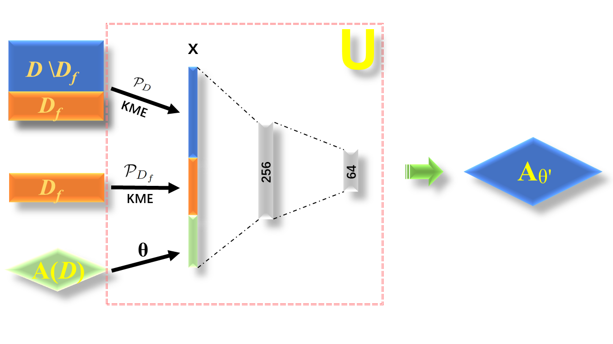

# KDC

# Distributed Clustering based on Distributional Kernel.

## Codes
The codes of centralized kbcc are in document _some_functions_.

The codes of distributed kbcc are in document _KDC_ray_.
### Ray: 
<https://www.ray.io/> 

<https://github.com/ray-project/ray>.

## Run
The file _Demo_KDC_KBCC.m_ shows an example of running KDC.

## Data
The datasets for distributed clustering are in the document _datasets_distributed_.

The datasets for centralized clustering are in the document _other_data_.

## Results
The parameters we used in the paper are shown in _results/parameters.png_

The results of the centralized clustering are shown in _results/ResultsofCentrailizedClustering.png_
